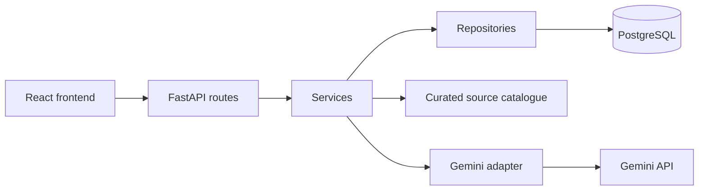

# GovReach AI

Generative AI for Egyptian government awareness campaign drafts, starting with
traffic safety in Egyptian Arabic and English.

[](https://github.com/YouusseefEhab/govreach-ai/actions/workflows/ci.yml)

GovReach AI is a graduation-project prototype combining campaign management,
API-based text generation, curated references, and review. Generated content stays
in draft until reviewed; approval does not publish it or imply government endorsement.

## Current capabilities

- Campaign CRUD with pagination and validation.
- Five-field text packages in Egyptian Arabic, English, or both.
- Curated WHO summaries supplied to generation, with stored source provenance.
- Generation history and original campaign/request snapshots.
- Partial editing and independent approval/rejection of each language.
- Edited packages reset to draft for another review.

The backend and Phase 3 pilot evaluation are complete. The frontend currently
contains an Arabic-default bilingual React layout, backend health check, paginated campaign list,
campaign creation/editing, saved campaign details, and confirmed deletion.
Text generation and saved draft/source display are available in the UI.
The UI also supports partial content edits, draft reset, and separate per-language
approval/rejection, an English interface switch, and exact-text copy controls.
The user confirmed the core workflow and mobile checks; keyboard testing is
deferred. See the [Phase 4 verification record](frontend/PHASE_4_VERIFICATION.md).
The [Phase 5 image foundation](docs/PHASE_5.md) adds separate request metadata,
source snapshots, request identity and local byte storage. Decoded-image validation
and a fake-default pipeline are available, with a rollback-only diagnostic.
A [Cloudflare image adapter](docs/CLOUDFLARE_SETUP.md) is implemented and mock-tested;
credentials/Free-plan access need setup. Image APIs, cleanup integration and UI are
not available yet. Paid image APIs are deferred. Video, authentication, publishing
and cloud deployment remain later.

## Technology and architecture

| Area | Stack |
| --- | --- |
| API | Python 3.12, FastAPI, Pydantic |
| Database | PostgreSQL 16, SQLAlchemy, Alembic |
| AI | Google Gemini API and official Python SDK |
| Frontend | React, TypeScript, Vite |
| Verification | pytest, API diagnostics, build/lint |



Redis is provisioned for future work; the current synchronous text pipeline does
not use a background worker.

## Local setup

Install Python 3.12, Node.js 24, npm, and Docker Desktop with Linux containers.
From the repository root in PowerShell:

```powershell
Copy-Item .env.example .env
docker compose up -d postgres redis
```

Copy the example only on a fresh checkout; preserve an existing `.env`. Add your
own `GEMINI_API_KEY` and replace the example JWT secret. Compose credentials are
development examples, not deployment secrets.

Start the backend:

```powershell
cd backend
py -3.12 -m venv .venv
.venv/Scripts/python.exe -m pip install -r requirements-dev.txt -c constraints.txt
.venv/Scripts/python.exe -m alembic upgrade head
.venv/Scripts/python.exe -m uvicorn app.main:app --reload
```

Open [API documentation](http://localhost:8000/docs). On Linux/macOS use
`python3.12 -m venv .venv` and `.venv/bin/python`. Runtime dependencies are in
`requirements.txt`; `constraints.txt` records the tested development environment.

In another terminal, start the frontend:

```powershell
cd frontend
npm ci
npm run dev
```

Open [the frontend](http://localhost:5173). Use `localhost` to match the existing
backend CORS origin. The browser does not need a Gemini key.

## API overview

| Method | Endpoint | Purpose |
| --- | --- | --- |
| GET | `/health` | Application responsiveness |
| GET / POST | `/api/v1/campaigns` | List/create campaigns |
| GET / PATCH / DELETE | `/api/v1/campaigns/{id}` | Read/edit/delete campaign |
| POST | `/api/v1/campaigns/{id}/generate-text` | Generate and save drafts |
| GET | `/api/v1/campaigns/{id}/contents` | Read generation history |
| GET / PATCH | `/api/v1/contents/{id}` | Read/edit/review package |

Campaign deletion also removes its generated content. Generation uses the stored
campaign language and accepts an audience and tone:

```json
{
  "audience": "السواقين والركاب في مصر",
  "tone": "informative"
}
```

Provider failures return controlled errors. A lost client connection does not
prove server cancellation; inspect saved history before submitting again.

## Verification

```powershell
# From backend: isolated tests, with no live Gemini calls
.venv/Scripts/python.exe -m pytest -q

# Optional PostgreSQL checks using temporary records and a fake provider
.venv/Scripts/python.exe -m alembic check
.venv/Scripts/python.exe -m scripts.check_generation_api
.venv/Scripts/python.exe -m scripts.check_image_pipeline

# From frontend
npm run lint
npm test
npm run build
```

The backend has 244 passing tests. The image diagnostic is fake by default;
`--cloudflare` makes one explicit image request after Free-plan configuration. Live text
diagnostics are opt-in: add `--live` to
`scripts.check_generation_api` for one provider request or run
`scripts.evaluate_text_generation --live` for three. Quotas/charges depend on API
project billing. Diagnostic rows are rolled back; captured IDs are not persistent.

## Evaluation and limitations

The three-topic pilot produced six structurally valid bilingual drafts. Every
topic required editorial corrections. Sources record supplied context, not
automatic sentence-level verification. See the [pilot report](backend/PHASE_3_EVALUATION.md)
for measured durations, raw evidence, proposed corrections, and limitations.
The review was Codex-assisted, not an independent human benchmark.

Never commit real credentials, private campaign data, or production exports.

## Documentation

- [Documentation index](docs/README.md)
- [Phase 2: campaign CRUD](backend/PHASE_2.md)
- [Phase 3: text generation and review](backend/PHASE_3.md)
- [Phase 3: pilot evaluation](backend/PHASE_3_EVALUATION.md)
- [Phase 4: frontend plan](frontend/PHASE_4.md)
- [Contribution guide](CONTRIBUTING.md)
- [Security guidance](SECURITY.md)

No project license has been selected. Do not assume an open-source license from
the repository's visibility.
